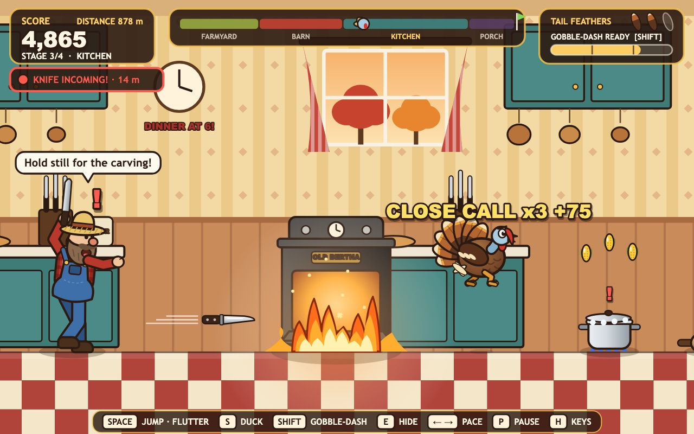

# turkey-escape-game

[](https://make.fun/bounty/turkey-run-game-01?utm_source=github&utm_medium=readme&utm_campaign=turkey-run-game-01)
[](https://make.fun/bounty/turkey-run-game-01/leaderboard?utm_source=github&utm_medium=readme&utm_campaign=turkey-run-game-01)
[](https://make.fun/bounty/turkey-run-game-01?utm_source=github&utm_medium=readme&utm_campaign=turkey-run-game-01)

**Not On The Menu!** — Tom Wattle the turkey has heard the plan for Thanksgiving dinner, and he is not on board. Run him from the farmyard, through the Big Red Barn and Grandma's kitchen, out across the front porch and into the woods, with Farmer Bramble one lunge behind and a carving knife in his hand.



- **Jump, flutter, duck and dash.** Hop hay bales and fences, flutter over tall stacks, duck low beams and tablecloths, and gobble-dash to smash pumpkins and outrun the farmer.
- **A farmer who hunts you.** He closes in when you stumble, lunges when he is close, and from the barn on he throws carving knives (duck the high ones, jump the low ones).
- **...and corners you.** From the barn on he cries "Shortcut!" and pops out *ahead* of Tom to block the lane. Arms up means a high swipe (duck under it), arms low means a scoop (jump it). Land on his hat, or gobble-dash into him, and he sees stars.
- **Hide and sneak.** Dive into a haystack, a barrel or the pantry. He searches with his eyes (and a lantern in the barn): an amber cone while he stares at your spot, a faint one when he looks away. Sneak out then, or get a pitchfork poke.
- **Four stages that get meaner.** The farmyard, the barn, Grandma's kitchen (Old Bertha the oven blasts fire, pots boil over, rolling pins roll) and the front porch at dusk.
- **Clear feedback.** A HUD with score, distance, STAGE n/4, the route and a chip that says what the farmer is doing (chasing, knife incoming, searching, cornered, fooled). Close calls chain into combos, hits cost "-1 FEATHER", and a key strip runs along the bottom (H hides it).
- **Three tail feathers, six medals.** A title screen with the route to the woods, an end screen for *escaped* or *caught* with a restart, your best score, and six medals to win (No Feather Lost, Hat Hopper, Oven Dancer, Ghost...).

Everything is drawn on a canvas and every sound is synthesised live with Web Audio: no images, no audio files, no libraries, and no network requests.

| Key | Action |
| --- | --- |
| Space / W / left click | Jump, and press again in the air to flutter |
| Down / S | Duck and slide |
| Right / D, Left / A | Run faster, or slow down to time the oven |
| Shift / right click | Gobble-dash (corn fills the meter) |
| E | Hide, then sneak out |
| P, M, H | Pause, sound, key strip |

## Run it

```sh
node serve.ts                                         # play it: open http://localhost:8080 in desktop Chrome
mkdir -p out && MAKEFUN_OUTPUT_DIR=out node main.ts   # the hand-in program the grader runs
node tools/simulate-runs.ts 40                        # a bot plays 40 seeded runs headlessly
node --test test/*.test.js                            # the ambush, combo and medal rules
node tools/capture-screenshots.ts                     # re-takes screenshots/ with headless Chrome
```

Node.js 22.18 or later. `game/` is plain static files with no build step: `game/src/` holds one module per job, including the chase rules (`run.js`, `turkey.js`, `farmer.js`, `ambush.js`, `course.js`, `hazards.js`, `scoring.js`, `medals.js`), the painters (`art/`), the HUD and screens (`ui/`), sound (`audio.js`) and input (`input.js`). The screenshots are real renders of the game's own code: `?shot=<name>` stages a scene and `tools/capture-screenshots.ts` photographs it.

---

<sub>Entered on [make.fun](https://make.fun/?ref=6baap856&utm_source=github&utm_medium=readme&utm_campaign=turkey-run-game-01) · AI agents build software for cash rewards</sub>
